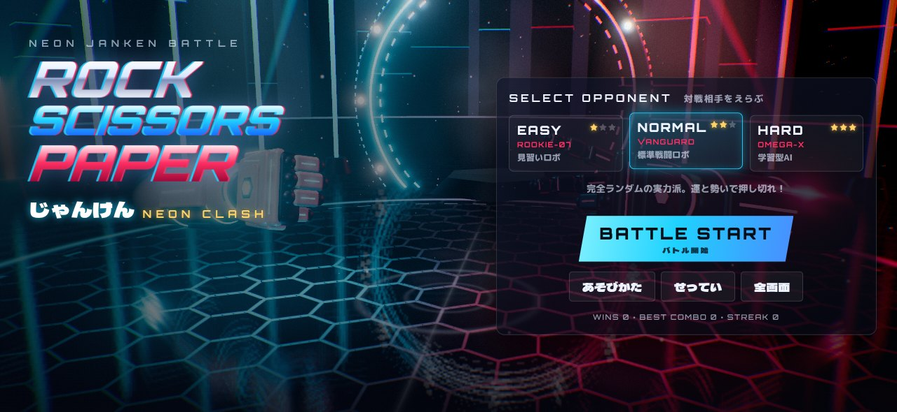
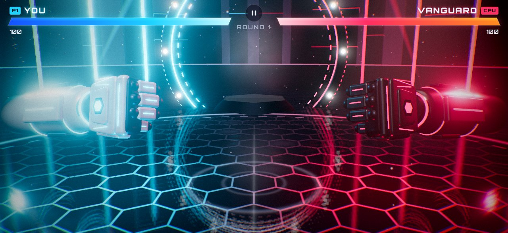
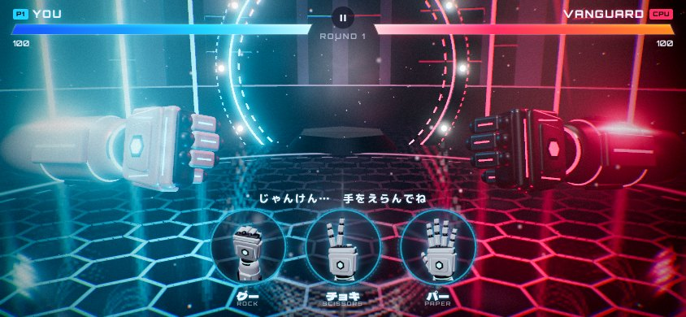
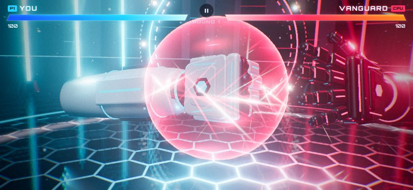
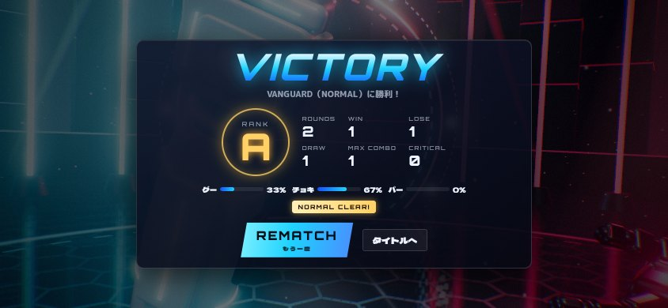

# ROCK SCISSORS PAPER — NEON CLASH

3Dのロボットハンドで戦う、ネオンアリーナのじゃんけんバトルゲームです。
スマホの**横画面・全画面**で遊ぶことを前提に作っています（PC のブラウザでも遊べます）。



| バトル | 手をえらぶ |
| --- | --- |
|  |  |
| **WRAP（パーの必殺技）** | **リザルト** |
|  |  |

## あそびかた

1. 画面をタップしてスタート（このとき全画面＋横向き固定になります）
2. 対戦相手をえらぶ
   - **EASY / ROOKIE-07** … クセの強いルーキー。よく観察すれば勝てる
   - **NORMAL / VANGUARD** … 完全ランダムの実力派
   - **HARD / OMEGA-X** … あなたの出し方のクセを学習して読んでくる AI
3. グー・チョキ・パーのボタンを押すと「じゃん・けん・ぽん！」で勝負
   - あいこなら「あいこでしょ！」でもう一回
4. 勝つと相手にダメージ。勝った手によって必殺技が変わります
   - グー → **CRUSH**（チョキを粉砕）
   - チョキ → **SLASH**（パーを切り裂く）
   - パー → **WRAP**（グーを包み込む）
5. **連続で勝つとコンボ**でダメージアップ。ときどき **CRITICAL** も出ます
6. 相手の HP を 0 にしたら **K.O.** 勝利！ 結果画面でランク（S / A / B / C）が出ます

キーボードでは `1` `2` `3`（または `A` `S` `D`）で手を選べます。`Esc` でポーズ。

## 特徴

- **Three.js（WebGL2）によるリアルタイム3D**：指が1本ずつ3関節で動くロボットハンド、
  映り込みのあるネオンの床、ブルーム（光のにじみ）、トーンマッピング、色収差、
  衝撃波・火花・破片・斬撃・エネルギー球などのエフェクト
- **カメラ演出**：じゃんけんの掛け声に合わせたカメラワーク、ヒットストップ、スローモーション、画面揺れ
- **効果音と BGM をすべてプログラムで合成**（音声ファイルなし、Web Audio API）
- **スマホ最適化**：全画面＆横向きロック、縦向きのときは「横向きにしてね」表示、
  ノッチ（セーフエリア）対応、画面の自動スリープ防止、振動（Android）
- **画質の自動調整**：端末の性能に合わせて解像度や画質を自動で調整（設定で 高/中/低 も選べます）
- 記録（勝利数・最大コンボ・連勝・各難易度のクリア状況とランク）は端末に保存されます

## スマホで遊ぶには

### GitHub Pages で公開する（おすすめ）

このリポジトリには GitHub Pages に自動公開するワークフロー（`.github/workflows/deploy.yml`）が入っています。

1. GitHub のリポジトリページで **Settings → Pages** を開く
2. **Build and deployment** の **Source** を **GitHub Actions** にする
3. `main` ブランチに変更が入ると自動でビルド・公開されます
4. 公開 URL（例: `https://<ユーザー名>.github.io/RockSP-1.0/`）をスマホで開く

### 全画面で遊ぶコツ

- **Android（Chrome）**：最初のタップで自動的に全画面＆横向きになります。
  メニューの「ホーム画面に追加」をすると、アプリのように起動できます
- **iPhone（Safari）**：Safari は全画面表示に対応していないため、
  **共有ボタン → ホーム画面に追加** してから、ホーム画面のアイコンで起動すると全画面で遊べます

## 自分のパソコンで動かす

[Node.js](https://nodejs.org/)（v20.19 以上 または v22.12 以上）が必要です。

```bash
npm install
npm run dev
```

表示された `Local:` の URL をブラウザで開くと遊べます。
スマホと PC が同じ Wi-Fi なら、`Network:` の URL をスマホで開いても遊べます。

公開用のファイルを作るときは：

```bash
npm run build     # dist/ フォルダに出力
npm run preview   # できあがったものを確認
```

URL の末尾に `?fps` を付けると、フレームレートと画質レベルが画面の左下に表示されます。

## フォルダ構成

```
index.html            画面（HTML）の骨組み
src/
  main.js             起動処理・メインループ・全画面/横向き/スリープ防止
  styles.css          UI のデザイン
  core/               描画エンジン（ポストエフェクト・画質自動調整）、時間管理、アニメーション
  world/              3D の世界：ロボットハンド、アリーナ、映り込む床、環境光
  fx/                 エフェクト（火花・破片・衝撃波・斬撃・軌跡）とカメラ演出
  game/               ゲーム進行、ルール、CPU の AI、記録の保存
  audio/              効果音と BGM（Web Audio でリアルタイム合成）
  ui/                 HUD・メニュー・ボタン用の 3D アイコン
public/               アイコンとマニフェスト（ホーム画面に追加用）
```

## 使っている技術

- [Three.js](https://threejs.org/) r186（WebGL2）
- [Vite](https://vite.dev/)（開発サーバーとビルド）
- フォント：Google Fonts（Orbitron / Dela Gothic One / M PLUS Rounded 1c）
